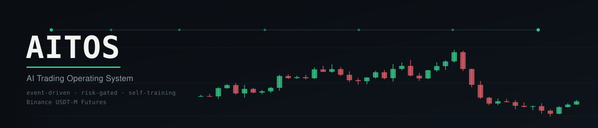

<p align="center">
  
</p>

<p align="center">
  
  
  
  
</p>

# AITOS — AI Trading Operating System

AITOS is an event-driven trading system for Binance USDT-M Futures. The current repository combines market-data ingestion, Redis Streams, ClickHouse persistence, optional Neo4j knowledge-graph support, risk controls, opportunity scanning, paper trading, guarded live execution, XAI/journaling, continual learning, historical replay/backtesting, health/metrics endpoints, and Docker-based deployment.

> **Canonical documentation:** this README is the project overview. For installation, follow the [AITOS Installation & Deployment Guide](INSTALLATION.md), which documents both desktop installation and VPS runtime deployment.

## Credential security and remote signing

Read [Credential Security & Remote Signing RFC](docs/CREDENTIAL_SECURITY_REMOTE_SIGNING_RFC.md) before entering exchange credentials on a remote host. OS vaults protect local storage, not against a provider administrator with root/administrator access to that same machine. The remote signer and live order-dispatch path are not implemented or authorized by this RFC.

## Read-only desktop console (local-first)

The [desktop Operator Console](desktop/README.md) is a read-only desktop interface for an already-running AITOS backend. Windows and Linux unsigned test installers are built by the native packaging workflows. It does not install or start the trading engine. For step-by-step installation and VPS connection, see [INSTALLATION.md](INSTALLATION.md). The shared public preview must stay unattached; this is not an exchange-key vault or permission to activate live trading.

## 🧭 Interactive Index

Click any topic below to jump directly to that section.

### 🚀 Getting Started

- [System at a glance](#system-at-a-glance)
- [Current capabilities](#current-capabilities)
- [Quick start](#quick-start)
- [Installation: Desktop or VPS](INSTALLATION.md)
- [VPS-free local development](docs/LOCAL_DEVELOPMENT.md)
- [Configuration](#configuration)
- [Runnable entrypoints](#runnable-entrypoints)

### 📈 Trading & Research

- [Backtesting](#backtesting)
- [Paper trading](#paper-trading)
- [Live trading](#live-trading)

### 🏗️ Deployment & Operations

- [Docker and VPS deployment](#docker-and-vps-deployment)
- [Dedicated VPS data disk](#dedicated-vps-data-disk)
- [CI/CD](#cicd)
- [Operations and troubleshooting](#operations-and-troubleshooting)
- [Storage and maintenance](#storage-and-maintenance)

### 📚 Reference

- [Project structure](#project-structure)
- [Safety boundaries](#safety-boundaries)
- [Credential security & remote signing](docs/CREDENTIAL_SECURITY_REMOTE_SIGNING_RFC.md)

---

## System at a glance

```text
                 Binance USDT-M Futures
                   REST / WebSocket
                          │
                          ▼
                 Market-data ingestion
                          │
                          ▼
                 Redis Streams Event Bus
                          │
          ┌───────────────┼────────────────┐
          ▼               ▼                ▼
      Risk Engine   Opportunity Scanner   Data/Journal
          │               │                │
          └───────────────┼────────────────┘
                          ▼
                   Trade Lifecycle
                     │         │
                     ▼         ▼
                   Paper      Live
                  Execution  Execution

   ClickHouse ── market history / journals / learning data
   Neo4j      ── optional knowledge graph
   XAI/ML/RL  ── explanations and continual-learning feedback
```

The core application is event-driven: components communicate through the Event Bus rather than relying on broad direct coupling. Production actions are additionally protected by risk controls and human-approval governance.

[↑ Back to Index](#-interactive-index)

## Current capabilities

| Area | Current implementation |
|---|---|
| Exchange | Binance USDT-M Futures REST + WebSocket adapter |
| Streaming | Redis Streams, consumer groups, ACK/DLQ handling, replay/request-reply |
| Persistence | ClickHouse for market data, journals and learning experience |
| Knowledge graph | Optional Neo4j integration |
| Intelligence | Opportunity scoring, market structure, volatility, CVD/order-flow, liquidity, funding, open interest and RL-related signals |
| Risk | Risk score, hard/soft limits, circuit breaker, correlated/sector exposure checks, position sizing and adaptive leverage |
| Execution | Simulated paper execution and separately guarded live execution |
| Live protection | Exchange-side protection/reconciliation where configured |
| Explainability | Trade explanations, counterfactuals and attention-based XAI |
| Learning | Online RL/ML feedback and continual-learning worker |
| Backtesting | Lightweight historical runner and richer L2/futures replay path |
| Operations | Health/metrics endpoints, structured JSON logging, Docker Compose |
| Deployment | GitHub Actions CI/CD with Docker and SSH-based VPS deployment |

[↑ Back to Index](#-interactive-index)

## Quick start

For a workstation-only setup with portable `./data` storage and no VPS credentials, follow the [VPS-free local development guide](docs/LOCAL_DEVELOPMENT.md).

### 1. Clone and create the environment

```bash
git clone https://github.com/fahadhossain0909/aitos.git
cd aitos
python3 -m venv .venv
source .venv/bin/activate
pip install -r requirements.txt
cp .env.example .env
```

### 2. Start local infrastructure

```bash
docker compose up -d redis clickhouse neo4j
```

The default paper-trading Docker service expects all three infrastructure services to become healthy. Redis is required for the Event Bus; ClickHouse and Neo4j are optional only for code paths that explicitly support running without persistence/graph storage.

### 3. Run paper trading locally

```bash
python3 run_paper_trading.py
```

The paper runner consumes public Binance market data and uses simulated execution. Binance API credentials are not required.

Health check:

```bash
curl http://localhost:8090/health
```

### 4. Run tests

```bash
PYTHONPATH=. pytest -v
```

Backtest-only tests:

```bash
python -m pytest -q tests/backtest
```

No fixed test count is documented because the suite changes as the project evolves.

[↑ Back to Index](#-interactive-index)

## Configuration

The tracked template is `.env.example`. Copy it to `.env` and keep the real file out of Git.

Important production values include:

```text
REDIS_PASSWORD
CLICKHOUSE_PASSWORD
NEO4J_PASSWORD
```

For live execution, also configure:

```text
BINANCE_API_KEY
BINANCE_API_SECRET
BINANCE_TESTNET=true
BINANCE_HEDGE_MODE=false
```

Keep `BINANCE_TESTNET=true` until live execution is deliberately enabled. Never grant withdrawal permission to a trading API key.

### Configuration rules

- Use strong, unique passwords for Redis, ClickHouse and Neo4j.
- Keep `REQUIRE_HUMAN_APPROVAL_FOR_PROD=true` for production operation.
- Do not commit `.env` or real credentials.
- `COMPOSE_PROJECT_NAME` is `aitos`.
- `BACKTEST_DATA_DIR` is used for optional local/historical replay data and cache.

[↑ Back to Index](#-interactive-index)

## Runnable entrypoints

| Command | Purpose | Endpoint |
|---|---|---|
| `python3 run_paper_trading.py` | Live public market data + simulated orders | `8090` |
| `python3 run_live_trading.py` | Guarded real/testnet execution | `8091` |
| `python3 run_continual_learning.py` | Continual-learning worker | — |
| `python3 -m aitos.backtest.cli` | Historical backtesting | — |
| `python3 -m aitos.backtest.rich_cli` | L2/futures historical replay | — |

[↑ Back to Index](#-interactive-index)

## Backtesting

Two supported interfaces are available:

```bash
python3 -m aitos.backtest.cli --help
python3 -m aitos.backtest.rich_cli --help
```

The richer replay path models historical trade/order-book events and supports L2 execution, queue lifecycle simulation, futures margin, funding and configurable decision strategies. The canonical historical runner implementation is `aitos/backtest/aitos_runner.py`.

For a lighter dependency set:

```bash
pip install -r requirements-backtest.txt
```

The Docker Compose backtest service is profile-gated:

```bash
docker compose --profile backtest run --rm aitos-backtest --help
```

[↑ Back to Index](#-interactive-index)

## Paper trading

```bash
python3 run_paper_trading.py
```

Paper trading uses live Binance public market data but does **not** submit real exchange orders. It is the recommended first runtime mode.

When using the Docker service:

```bash
docker compose up -d
docker compose ps --all
docker compose logs -f aitos-paper
```

The default Compose paper service waits for Redis, ClickHouse and Neo4j health checks before starting.

[↑ Back to Index](#-interactive-index)

## Live trading

**Live trading is safety-critical. `run_live_trading.py` can place real orders.**

Before enabling it:

1. Test with Binance testnet first.
2. Verify API permissions and never enable withdrawals.
3. Confirm `BINANCE_HEDGE_MODE` matches the account's position mode.
4. Verify risk limits, circuit-breaker behavior and human approval.
5. Start only when you explicitly intend to submit orders.

The Docker live service is behind the `live` Compose profile and is not started by the normal default stack:

```bash
docker compose --profile live run --rm aitos-live
```

Do not use the live profile as a substitute for understanding the live-trading entrypoint and its approval flow.

[↑ Back to Index](#-interactive-index)

## Docker and VPS deployment

The canonical, step-by-step deployment procedure is maintained in the [AITOS Installation & Deployment Guide](INSTALLATION.md#method-2--deploy-the-aitos-runtime-on-a-vps). It covers VPS prerequisites, persistent data-disk preparation, GitHub Actions environment/secrets, immutable image deployment, health checks, maintenance and rollback.

For desktop installation and connecting the read-only console to a VPS over SSH, see [Method 1](INSTALLATION.md#method-1--install-the-desktop-operator-console).

[↑ Back to Index](#-interactive-index)

## CI/CD

GitHub Actions validates formatting, tests and security checks before deployment. Production deployment uses the configured VPS environment and does not expose infrastructure ports publicly.

[↑ Back to Index](#-interactive-index)

## Operations and troubleshooting

### Check service state

```bash
docker compose ps --all
```

### Inspect logs

```bash
docker compose logs --tail=200 aitos-paper
docker compose logs --tail=200 redis
docker compose logs --tail=200 clickhouse
docker compose logs --tail=200 neo4j
```

### Health endpoints

```bash
curl http://localhost:8090/health
curl http://localhost:8090/metrics
```

### Redis connectivity

```bash
docker compose exec redis redis-cli -a "$REDIS_PASSWORD" PING
```

### ClickHouse connectivity

```bash
docker compose exec clickhouse clickhouse-client --query 'SELECT 1'
```

### Disk usage

```bash
df -hT /mnt/aitos-data
du -sh /mnt/aitos-data/*
```

Do not delete Redis, ClickHouse or Neo4j files manually while the corresponding service is running.

[↑ Back to Index](#-interactive-index)

## Storage and maintenance

Storage maintenance is profile/service based and should be run deliberately on production systems. Monitor the dedicated data disk before it approaches capacity.

[↑ Back to Index](#-interactive-index)

## Project structure

```text
aitos/
├── aitos/
│   ├── backtest/
│   ├── core/
│   ├── data/
│   ├── execution/
│   ├── learning/
│   ├── monitoring/
│   ├── risk/
│   ├── strategy/
│   └── xai/
├── scripts/
├── tests/
├── docker-compose.yml
├── Dockerfile
├── requirements.txt
├── requirements-backtest.txt
├── .env.example
└── README.md
```

[↑ Back to Index](#-interactive-index)

## Safety boundaries

AITOS is a trading system, not a guarantee of profit. Paper trading and testnet should be used before live execution. Live execution requires deliberate configuration, valid credentials, risk limits and human approval where configured.


### Execution integrity and recovery status

The canonical live runner now uses confirmed terminal fills, durable market-order
intent quarantine, actual reduce-only exits, write-through lifecycle application,
account snapshot checks and single-runtime capital ownership. Current Binance
conditional protection uses the separate algo-order API; old persisted order IDs
retain compatibility. These changes are not a production-readiness or live-activation
claim. Protective pre-submit recovery, service-backed fault evidence, supported
broker integrations, paper soak and latency gates remain open. See
[Execution recovery operations](docs/EXECUTION_RECOVERY.md) and the
[dated implementation evidence](engineering/EXECUTION_RECOVERY_IMPLEMENTATION_2026-11-07.md).

## Paper shadow and Windows console preparation

Default-off paper runner mirroring and Windows x64 native vault/installer source
are documented in [implementation evidence](engineering/WINDOWS_PAPER_INTEGRATION_2026-11-06.md)
and [Windows setup](native/windows/README.md). This is not a production journal
cutover or an available signed release. Actual service/Windows validation and
[independent review](engineering/PAPER_NATIVE_REVIEW_BUNDLE.md) remain gates.

## Offline recorded-account reconciliation

Use `python -m aitos.exchange.binance_account_evidence expected-schema2.json recorded-bundle.json`
for read-only exact comparison of independently prepared expected values against
recorded Binance-shaped paper/testnet responses. No account requests/credentials
or financial mutations. See [contract and verification](engineering/BINANCE_ACCOUNT_EVIDENCE_2026-11-06.md)
for schema, supported subset, pagination limitations and pending real-provider gates.

## Hosted Windows and service validation

Actual hosted Windows vault/build/install/network/uninstall and disposable service
restart/soak checks have now passed. An **unsigned Windows test candidate** is
available; it is not a signed production release. Current artifact links, tested
commit, seven workflow results, 300-second soak, review request and remaining gates:
[remote validation evidence](engineering/REMOTE_VALIDATION_EVIDENCE.md). No main
merge, production cutover, trusted signing or live capability was activated.

## Advanced-main integration evidence

Main `e332e2b9` is fully included on this arena branch in tested merge `58807516`.
Eight isolated hosted validations passed, including real PostgreSQL/ClickHouse
reconciliation and Windows unsigned install/uninstall. See the
[main integration review](engineering/MAIN_INTEGRATION_REVIEW.md) for comparison,
conflict decisions, current artifacts, exact evidence and remaining gates. This
is not a main release, trusted signature or production/live activation.
